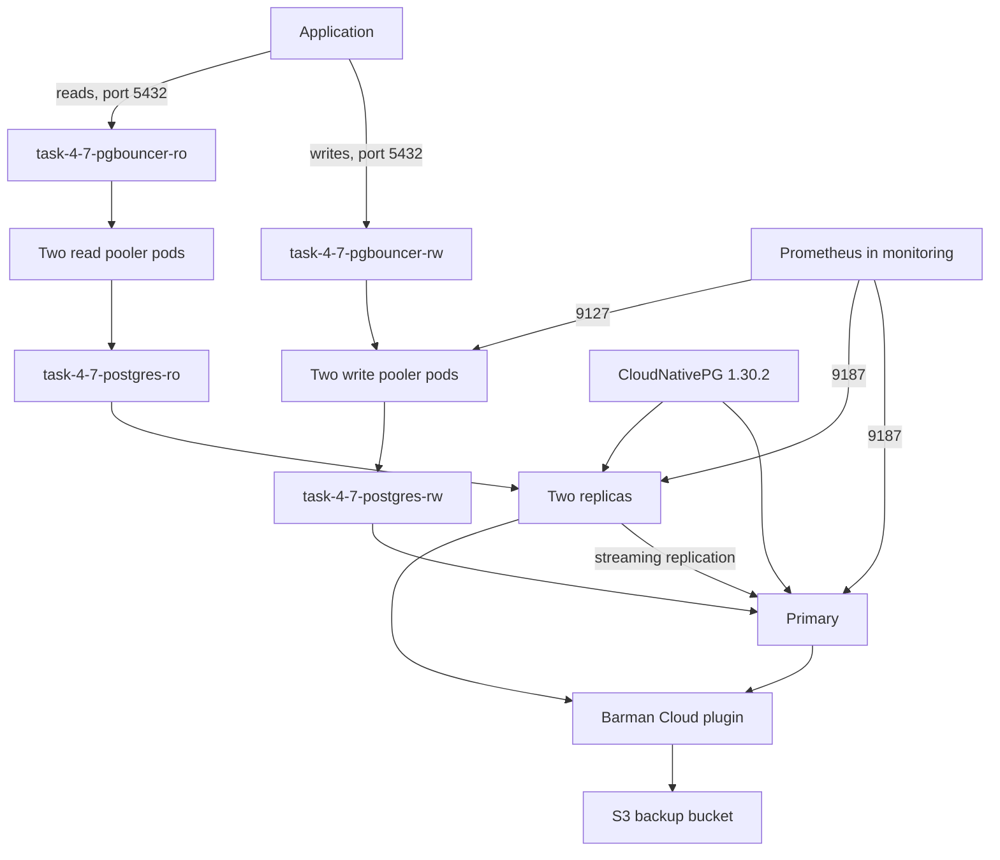

# PostgreSQL on Kubernetes — Architecture and How It Works

## 1. Overview

This setup runs a highly available PostgreSQL database inside the Kubernetes cluster.

It is deployed in the `ayananth-ts` namespace on the `kubenine-intern` cluster. The design includes:

- **One PostgreSQL cluster with three instances:** one primary and two replicas.
- **Two PgBouncer poolers:** one endpoint for writes and another for reads.
- **Automatic failover:** CloudNativePG manages database roles and recovery when an instance fails.
- **Backups:** base backups and WAL files are sent to Civo Object Storage.
- **Monitoring and alerts:** the existing Prometheus and Grafana stack in the `monitoring` namespace is reused.
- **NetworkPolicies:** control which components are allowed to connect to PostgreSQL and PgBouncer.

The application does not connect directly to individual PostgreSQL pods. It connects to the appropriate PgBouncer Service:

- Writes → `task-4-7-pgbouncer-rw`
- Reads → `task-4-7-pgbouncer-ro`

This keeps the application connection details stable even when the primary changes during failover.

## 2. Architecture diagram





## 4. What each component does

| Component               | What it does                                                          | Why it is used                                                                                                                                                                                                                                                              |
| ----------------------- | --------------------------------------------------------------------- | --------------------------------------------------------------------------------------------------------------------------------------------------------------------------------------------------------------------------------------------------------------------------- |
| `task-4-7-postgres`     | CloudNativePG cluster running three PostgreSQL 18.3 instances         | The CloudNativePG operator was already installed in `cnpg-system` (version 1.30.2). It manages the database instances, primary/replica roles, failover, Services and metrics. Installing another PostgreSQL operator would add another control plane without a need for it. |
| Storage                 | Each instance has its own 5Gi `civo-volume` PVC                       | A persistent volume keeps database files when a pod is recreated. Required pod anti-affinity on `kubernetes.io/hostname` spreads the three instances across different nodes.                                                                                                |
| `task-4-7-pgbouncer-rw` | Two PgBouncer pods configured as `type: rw`                           | Applications use this endpoint for writes. It connects to whichever instance is currently primary.                                                                                                                                                                          |
| `task-4-7-pgbouncer-ro` | Two PgBouncer pods configured as `type: ro`                           | Applications use this endpoint for reads. It connects to the replicas, not the primary.                                                                                                                                                                                     |
| Backups                 | Barman Cloud plugin 0.16.0 and ObjectStore `task-4-7-postgres-backup` | CloudNativePG uses the plugin to archive WAL and store backups in object storage. This avoids introducing a separate backup system such as pgBackRest.                                                                                                                      |
| Monitoring              | PodMonitors, one PrometheusRule and two Grafana dashboards            | The existing Prometheus in `monitoring` already collects metrics. Reusing it keeps monitoring and alerts in one place.                                                                                                                                                      |
| Network                 | Three ingress NetworkPolicies                                         | They restrict incoming connections to the database and pooler pods. Flannel CNI on this cluster enforces these policies.                                                                                                                                                    |

### Why use a database operator instead of a Deployment or StatefulSet?

A normal Deployment is not a good fit for a database. A Deployment is designed for interchangeable application pods; it does not manage database roles, replication or failover.

A StatefulSet gives database pods stable names and persistent volumes. However, it does not, by itself, manage PostgreSQL promotion, replica recovery, WAL archiving or connection routing.

A database operator handles these database-specific tasks. CloudNativePG continuously checks the cluster and works to keep the intended arrangement: one primary and two replicas.

This cluster uses:

- `primaryUpdateStrategy: unsupervised`
- `failoverDelay: 0`

These settings allow the operator to initiate failover automatically when the primary becomes unavailable.

### Database resource limits

The database resources are intentionally modest because this is a shared Kubernetes cluster.

| Setting | Value |
|---|---:|
| CPU request | 100m |
| Memory request | 128Mi |
| CPU limit | 500m |
| Memory limit | 512Mi |
| `max_connections` | 50 |
| `shared_buffers` | 128MB |

PostgreSQL has a limit of 50 connections. PgBouncer is used in front of it so that many application clients can share a smaller number of PostgreSQL server connections.

## 5. Database credentials

The application database is named `app`, and its owner is also `app`.

The application gets its database username and password from this Kubernetes Secret:

`task-4-7-postgres-app`

The password is stored in the Secret, not written directly into the application manifest.

There is no superuser Secret in this namespace. This means the application is not given a PostgreSQL superuser password.

Other credentials are stored separately:

| Secret | Purpose |
|---|---|
| `task-4-7-postgres-app` | Application database credentials |
| `task-4-7-postgres-replication` | TLS credentials used for streaming replication |
| `task-4-7-postgres-s3-credentials` | Object storage credentials: `ACCESS_KEY_ID`, `ACCESS_SECRET_KEY` and `REGION` |

## 6. Network access: who is allowed to connect?

The three NetworkPolicies are ingress-only. They control incoming connections but leave egress open. Egress is needed for DNS, replication, the Barman plugin and uploads to object storage.

The rules below describe the configured access:

| Destination                          | Allowed sources                                                                                     |
| ------------------------------------ | --------------------------------------------------------------------------------------------------- |
| PostgreSQL port `5432`               | Other PostgreSQL instances, the CloudNativePG operator in `cnpg-system`, and both PgBouncer poolers |
| PostgreSQL metrics port `9187`       | Prometheus Service `prometheus-stack-kube-prom-prometheus` in `monitoring`                          |
| PostgreSQL port `8000`               | All sources, so kubelet probes can reach it                                                         |
| Either PgBouncer port `5432`         | All sources, so application connections and TCP readiness checks can reach it                       |
| Either PgBouncer metrics port `9127` | Prometheus                                                                                          |
|                                      |                                                                                                     |
|                                      |                                                                                                     |

Anything not allowed by the policies is denied. This was tested: a read-pooler pod could not connect to PostgreSQL on port `5432` until the required rule was added.

### Which database Services can an application reach?

An application pod can connect to:

- `task-4-7-pgbouncer-rw:5432`
- `task-4-7-pgbouncer-ro:5432`

It cannot directly connect to:

- `task-4-7-postgres-rw`
- `task-4-7-postgres-ro`
- `task-4-7-postgres-r`

The PostgreSQL Services are intended for the poolers and cluster components. In particular, `-r` selects any available instance; it is not an application-facing endpoint in this design.

Port `8000` is used for health checks and CloudNativePG management. The probe paths and `/pg/status` are reachable. The operator's control socket on this port still requires the operator client certificate.

## 7. How application writes reach PostgreSQL

For a write, the application connects to:

`task-4-7-pgbouncer-rw.ayananth-ts.svc.cluster.local:5432`

It uses database `app` and the credentials from Secret `task-4-7-postgres-app`.

The request follows this path:

1. **The application connects to the write pooler.** The Service currently has two PgBouncer pod endpoints: `10.42.0.200` and `10.42.1.60`. Kubernetes sends the connection to one of them. The NetworkPolicy `task-4-7-pgbouncer-ingress` allows the connection.

2. **PgBouncer manages the client connection.** The pooler uses transaction pooling. It assigns a PostgreSQL server connection when a transaction needs one and returns that server connection to the pool when the transaction ends.

3. **PgBouncer connects to the current primary.** It uses `task-4-7-postgres-rw:5432`. That Service has one endpoint: the current primary, which was `task-4-7-postgres-2` (`10.42.1.67`) when checked.

4. **PostgreSQL runs the write.** The primary executes the statement. When the transaction commits, PostgreSQL flushes the commit's WAL record to its own persistent volume and acknowledges the commit.

5. **PgBouncer returns the result.** At the end of the transaction, PgBouncer releases the server connection back into its pool. The application client connection can then use a different server connection for its next transaction.

The pooler settings are:

| Setting | Value | Meaning |
|---|---:|---|
| `poolMode` | `transaction` | A server connection is assigned for a transaction, not for the full client session |
| `max_client_conn` | 100 per pod | Maximum client connections accepted by each pooler pod |
| `default_pool_size` | 10 | Normal server connections per database/user pool |
| `reserve_pool_size` | 2 | Additional server connections available when the normal pool is busy |

Each write-pooler pod can therefore use up to 12 PostgreSQL server connections for the `app` pool. There are two write-pooler pods.

The PostgreSQL `max_connections` value is 50. The connection budget also needs to account for replication and monitoring connections.

### What happens to the data after a write?

After the primary commits a transaction, it streams WAL changes to both replicas. The Barman plugin also archives completed WAL segments to object storage.

These are important for replication and recovery, but they are not part of the immediate response path to the application. The application receives its commit response from the primary.

**Important:** synchronous replication is not enabled. The primary does not wait for a replica to confirm that it has received the commit before acknowledging it.

### Why transaction pooling?

With transaction pooling, an application can have many client connections while PgBouncer reuses a smaller number of PostgreSQL server connections.

With session pooling, a server connection stays assigned to a client for the whole session. A large number of idle clients could therefore consume a large number of PostgreSQL connections.

Transaction pooling has a trade-off: session-level state is not guaranteed to remain available after a transaction. Features such as session-level `SET` values, temporary tables, advisory locks and `LISTEN` need special care because the next transaction may use a different PostgreSQL connection.

## 8. How application reads reach PostgreSQL

For reads, the application connects to:

`task-4-7-pgbouncer-ro.ayananth-ts.svc.cluster.local:5432`

The database name and credentials are the same as for writes. Only the Service is different.

The read path works as follows:

1. The read pooler Service sends the connection to one of its two PgBouncer pods (`10.42.0.249` or `10.42.1.68`).
2. The read pooler is configured as `type: ro`.
3. It connects to `task-4-7-postgres-ro`.
4. That PostgreSQL Service selects the two replicas (`10.42.0.218` and `10.42.3.82`).
5. PostgreSQL runs the read on the selected replica.

A replica is in recovery mode. You can check this with `pg_is_in_recovery()`: it returns `true` on a standby. A standby rejects write statements.

### Which endpoint should the application use?

| Application operation | Endpoint |
|---|---|
| Insert, update or delete | `task-4-7-pgbouncer-rw` |
| Read that must immediately see a recent write | `task-4-7-pgbouncer-rw` |
| Read that can tolerate replication delay | `task-4-7-pgbouncer-ro` |

The write endpoint always follows the primary. The read endpoint selects replicas, keeping ordinary read traffic away from the primary.

### Replication lag and stale reads

The primary sends WAL changes to its replicas. A replica may take some time to replay those changes.

That delay is called **replication lag**.

For example:

1. The application inserts a row through the write endpoint.
2. The primary commits the row and returns success.
3. The replica has not replayed that WAL record yet.
4. A read sent immediately to the read endpoint may not show the new row.

The configured `PostgreSQLReplicationLag` alert fires if a replica stays more than 30 seconds behind for 5 minutes.

The primary is excluded from this alert because `cnpg_pg_replication_in_recovery` is `0` on the primary. After failover, the alert applies to whichever instances are replicas.

## 9. What happens when the primary pod fails?

The cluster is configured for automatic failover. With `failoverDelay: 0` and `primaryUpdateStrategy: unsupervised`, CloudNativePG can begin failover when it detects that the primary is unavailable.

Deleting the primary pod is an example of an unplanned failover. A planned switchover is different: the operator waits for the selected replica to catch up before promoting it.

### Failover sequence

1. **The primary pod becomes unavailable.** Its readiness check on port `8000` fails. Kubernetes removes it from the endpoints of `task-4-7-postgres-rw`. Transactions that were running on that pod may fail.

2. **CloudNativePG detects the failure.** The operator reconciles the cluster and starts the failover process. The cluster phase changes to `Failing over`.

3. **The operator selects a replica.** WAL receivers stop, and the operator coordinates promotion. A ready replica is selected, preferring the one with the least replication lag. The candidate must hold the cluster Lease in `ayananth-ts`, which helps prevent two instances from promoting at the same time.

4. **The selected replica becomes the new primary.** It leaves recovery mode, becomes writable and starts a new timeline. CloudNativePG updates the instance role labels.

5. **The PostgreSQL Services update automatically.** `task-4-7-postgres-rw` now points to the new primary. `task-4-7-postgres-ro` points to the remaining replica. `task-4-7-postgres-r` continues to select all ready instances.

6. **The write pooler reconnects.** PgBouncer continues using the same Service name, `task-4-7-postgres-rw`. Connections that were using the failed pod return errors and are discarded. New server connections go to the new primary. The application must retry transactions that failed during the outage.

7. **The old primary rejoins as a replica.** Kubernetes recreates the old instance using its existing pod identity and 5Gi volume. If its data directory belongs to the old timeline, CloudNativePG uses `pg_rewind` to bring it in line with the new primary. If the volume is unavailable, the operator can rebuild the replica from a backup.

Until the old primary has rejoined, the cluster has one primary and only one available replica. Reads can still work through the read pooler, but read capacity is reduced. There is also one fewer standby available if another failure occurs during this period.

### Will every successful write survive a primary failure?

Not necessarily. This cluster uses **asynchronous replication**.

That means the primary can acknowledge a commit before either replica has received it. If the primary fails during that short window, a commit that was acknowledged by the old primary but had not reached either replica may be lost during promotion.

The old primary's remaining WAL cannot simply be added to the new primary's timeline. When it rejoins, `pg_rewind` aligns it with the new timeline.

Synchronous replication can reduce this risk. For example, setting `postgresql.synchronous.number: 1` makes a commit wait for one synchronous standby. The trade-off is that writes can stall if a suitable replica is unavailable or behind. Synchronous replication is **not enabled** in this cluster.

A planned switchover is safer in this respect because the operator waits for the chosen replica to catch up before promoting it.

### What if someone accidentally deletes data?

An accidental SQL `DELETE` is different from a pod failure.

If the delete commits, it is replicated like any other committed change and can also be archived in WAL. A failover will not undo that delete. To recover the deleted data, use point-in-time recovery (PITR), described below.

## 10. Backups and point-in-time recovery (PITR)

### Where backups are stored

The Barman Cloud plugin runs as a sidecar on each PostgreSQL instance and is configured with `isWALArchiver: true`. It uses ObjectStore `task-4-7-postgres-backup`.

| Setting                 | Configured value                                                  |
| ----------------------- | ----------------------------------------------------------------- |
| Object storage path     | `s3://task-4-7-postgres-backups-ayananth-2026/task-4-7-postgres/` |
| Server name             | `task-4-7-postgres`                                               |
| Base backup compression | gzip                                                              |
| Base backup encryption  | AES256                                                            |
| Base backup jobs        | 2                                                                 |
| WAL compression         | gzip                                                              |
| WAL encryption          | AES256                                                            |
| WAL parallelism         | `maxParallel: 2`                                                  |
| Credentials             | Secret `task-4-7-postgres-s3-credentials`                         |

### Base backup vs WAL archive

These two backup components work together:

- **Base backup:** a copy of the database data directory at a particular point in time.
- **WAL archive:** the sequence of database changes made after that base backup.

PITR uses a base backup and then replays archived WAL until the requested recovery time.

A base backup alone can only restore the database to the time represented by that backup. WAL alone is not enough because PostgreSQL needs a base backup onto which it can replay those changes.

### Completed backups

Two backups had completed when this document was prepared:

| Backup | Started (UTC) | Stopped (UTC) |
|---|---|---|
| `task-4-7-postgres-backup` | 2026-11-18 12:21:12 | 2026-11-18 12:21:19 |
| `task-4-7-postgres-daily-20261119020000` | 2026-11-19 02:00:01 | 2026-11-19 02:00:10 |

The scheduled backup is `task-4-7-postgres-daily`. Its cron expression is `0 0 2 * * *`, which runs daily at **02:00 UTC**. The run at that time created the second Backup object.

### How to restore to a previous time

Restore into a **new PostgreSQL Cluster**. Do not reuse the live cluster name or its PVCs: doing so risks replacing the database that is still running.

The restore cluster must also use a different archive `serverName` if it writes to the same bucket. Otherwise, it could overwrite the backup stream being used as the restore source. Leaving the restore cluster's `serverName` unset makes it default to the new cluster name.

Example restore manifest:

```yaml
apiVersion: postgresql.cnpg.io/v1
kind: Cluster
metadata:
  name: task-4-7-postgres-restore
  namespace: ayananth-ts
spec:
  instances: 3
  imageName: ghcr.io/cloudnative-pg/postgresql:18.3-system-trixie
  storage:
    storageClass: civo-volume
    size: 5Gi
  bootstrap:
    recovery:
      source: task-4-7-postgres
      recoveryTarget:
        # Choose a time just before the unwanted change.
        # Include the timezone.
        # Omit recoveryTarget to replay through the available WAL.
        targetTime: "2026-11-19T01:55:00Z"
  externalClusters:
    - name: task-4-7-postgres
      plugin:
        name: barman-cloud.cloudnative-pg.io
        parameters:
          barmanObjectName: task-4-7-postgres-backup
          serverName: task-4-7-postgres
```

In this example, the target time is `2026-11-19T01:55:00Z`.

The operator chooses a base backup that can reach the target time, then replays WAL until that point. You normally do not need to specify a backup ID. PostgreSQL stops at the first commit after the target time.

The selected target time must be within the available backup and WAL history. If the archive does not contain the WAL needed to reach that time, recovery cannot complete.

After the new cluster becomes healthy:

1. Connect to it using the `app` user.
2. Check that the required rows or tables are present.
3. Verify the recovered data before directing application traffic to it.
4. Update the application to use the new cluster's pooler endpoints when you are ready.

If you set `backupID`, the restore uses that specific base backup and stops at that backup rather than replaying forward to a later target time.

## 11. Monitoring and alerting

The existing Prometheus Service `prometheus-stack-kube-prom-prometheus` in the `monitoring` namespace collects metrics from this PostgreSQL setup.

No second Prometheus instance was installed. The PodMonitors and PrometheusRule use the label `release: prometheus-stack`, which allows the existing Prometheus to discover them.

CloudNativePG's own PodMonitor generation is disabled with `spec.monitoring.enablePodMonitor: false` to avoid creating a duplicate monitor.

Grafana loads two dashboards from ConfigMaps labeled `grafana_dashboard=1`:

- `task-4-7 PostgreSQL ayananth`
- `task-4-7 PgBouncer ayananth`

### What Prometheus scrapes

| Metric source | Target pods | Port | Scrape interval |
|---|---|---:|---:|
| PostgreSQL instance manager | Pods labeled `cnpg.io/podRole=instance` | 9187 | 30 seconds |
| Write PgBouncer pooler | Pods labeled `cnpg.io/poolerName=task-4-7-pgbouncer-rw` | 9127 | 30 seconds |
| Kubelet metrics (already installed) | The three PVCs and their containers | — | Provides CPU, memory and volume usage |

The read pooler allows Prometheus to reach port `9127`, but it does not have a PodMonitor. Therefore, its pool metrics are not included in these alerts.

Some metrics are deliberately filtered: Go runtime series are dropped, and `pg_settings` series are dropped except for `max_connections` and `superuser_reserved_connections`.

### Alerts configured

The PrometheusRule is named `task-4-7-postgres`. Alerts are evaluated by the Alertmanager already installed with the Prometheus stack. This project does not configure a new notification receiver.

| Alert | Fires after | Severity | What it means | What to check |
|---|---:|---|---|---|
| `PostgreSQLInstanceDown` | 5m | Critical | A known target exists, but `up == 0`. | Check the pod and whether NetworkPolicy allows Prometheus to reach port `9187`. |
| `PostgreSQLInstanceMissing` | 10m | Critical | One of the expected instance targets (`-1`, `-2` or `-3`) has disappeared from Prometheus. | Check whether the pod or target is gone. The 10-minute delay allows for a normal restart. If the target appears healthy, check whether Prometheus can store samples. |
| `PostgreSQLHealthyInstancesLow` | 5m | Critical | Fewer than three instances report `cnpg_collector_up == 1`. | Check whether the collector can reach PostgreSQL. A failover may be in progress. Confirm that the `-rw` Service has a primary. |
| `PostgreSQLReplicationLag` | 5m | Warning | A replica is more than 30 seconds behind. | Reads through `-ro` may return stale data. Check the primary and the replica's WAL receiver. |
| `PostgreSQLConnectionsHigh` | 10m | Warning | A PostgreSQL instance is using more than 80% of its 50 allowed connections. | Check for leaked server connections or clients bypassing PgBouncer. `superuser_reserved_connections` is 3. |
| `PostgreSQLStorageUsageHigh` | 15m | Warning | A 5Gi PVC is more than 80% full. | Identify what is using the disk and expand the PVC before it fills. WAL and object-storage backups do not free space on the PVC. |
| `PostgreSQLWALArchiveFailures` | 5m | Warning | The primary's WAL archive failure counter has increased during the last 15 minutes. | Check the Barman plugin and object-storage Secret. PITR cannot advance normally while WAL archiving is failing. |
| `PostgreSQLWALArchiveStuck` | 10m | Warning | WAL files have remained in `archive_status/ready` for 10 minutes. | Check the same upload path used by the archive-failure alert. An idle primary with no new WAL to archive is not, by itself, a problem. |
| `PostgreSQLBackupFailed` | 5m | Critical | The most recent failed Barman backup is newer than the most recent successful backup. | Inspect the failed Backup object's status. The last successful backup may still be usable. |
| `PgBouncerClientsWaiting` | 5m | Warning | A client is waiting for a server connection in a write-pooler database/user pool. | The normal pool is busy and the reserve is exhausted. Waiting clients have not started their database work. |
| `PgBouncerPoolSaturated` | 10m | Warning | `sv_active` for a write-pooler pool is at least 10. | The pool has reached its `default_pool_size`. It can still use up to two reserve connections before clients need to wait. |


### Backup-staleness alert

`PostgreSQLBackupStale` is present as a comment in the rule file, with a 24-hour threshold, but it is **not active** because it is commented out.

The daily backup schedule now exists, and the dashboard displays backup age. Uncomment and load this alert if you want Prometheus to alert when the latest backup becomes too old.

The backup-failure alert uses these Barman plugin metrics:

- `barman_cloud_cloudnative_pg_io_last_failed_backup_timestamp`
- `barman_cloud_cloudnative_pg_io_last_available_backup_timestamp`

The `cnpg_collector_last_*_backup_timestamp` gauges remain at zero for this plugin, so they are not the correct metrics for this alert.

